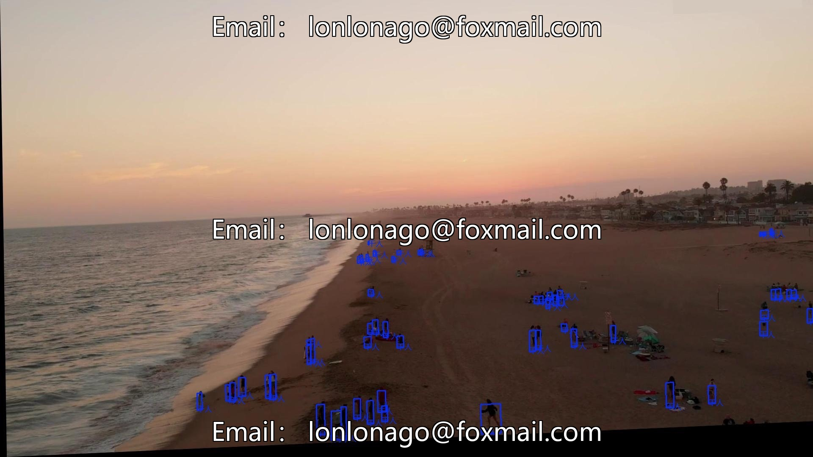
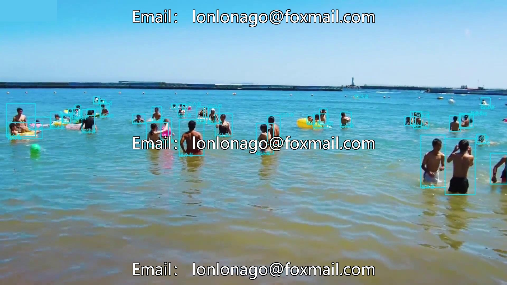
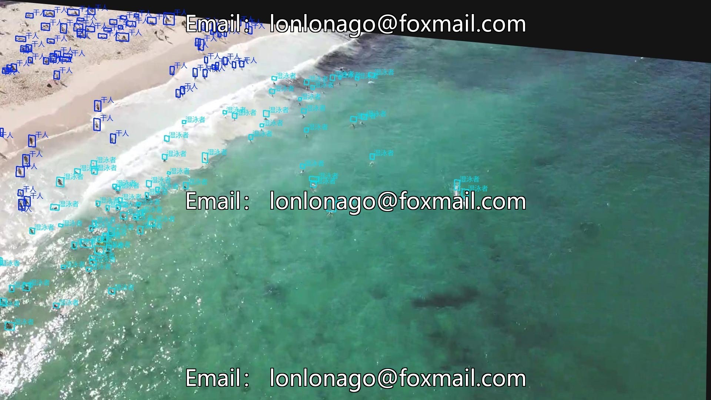
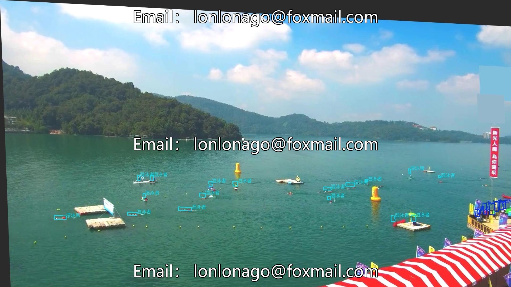

# UAV Beach Small Object Detection Dataset, based on Deep Learning CNN Yolo26

## Body

UAV Beach Small Object Detection Dataset, Deep Learning CNN-based Yolo26, Issue 10631: Research on Pedestrian Small Object Detection in UAV Aerial Photos of Beach Scenery

The dataset consists of 1500 high-resolution aerial images, all of which belong to the pedestrian category. It is in the format of Yolo+VOC and supports training with mainstream detection frameworks (such as Yolo v5/v8, Faster R-CNN, etc.). The annotation files are compatible with dual formats and can be directly used.

Data covers different weather conditions, time periods, pedestrian density changes. The annotation has been verified multiple times, suitable for scenarios such as small object detection algorithms research, intelligent drone monitoring, crowd density statistics, drowning risk warning, etc., promoting related technological breakthroughs.

Virtual materials, once sold, are non-refundable.
Interested friends, click "I want" to proceed.

## Images

## Payment

Here is a pay link on Stripe ( https://buy.stripe.com/3cs8yP7sY87d0vu9AB ). Please contact me lonlonago@foxmail.com after funding $89, and I will send you a complete data files , thank you!

